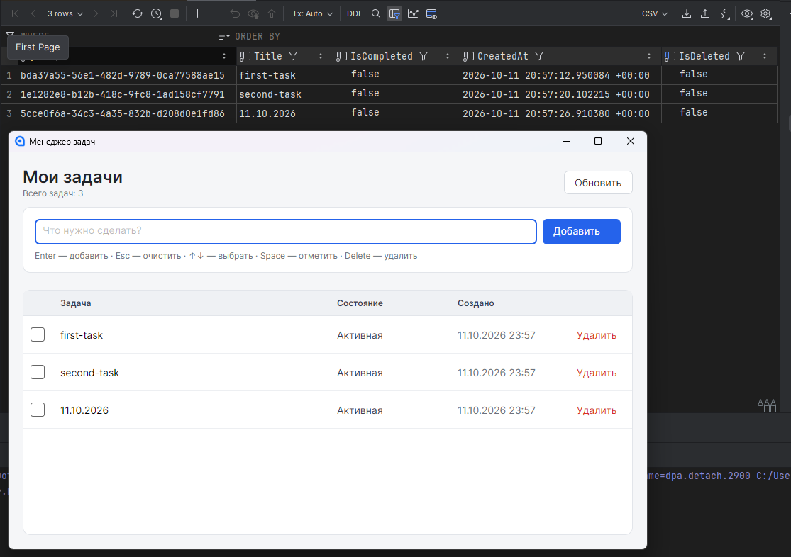
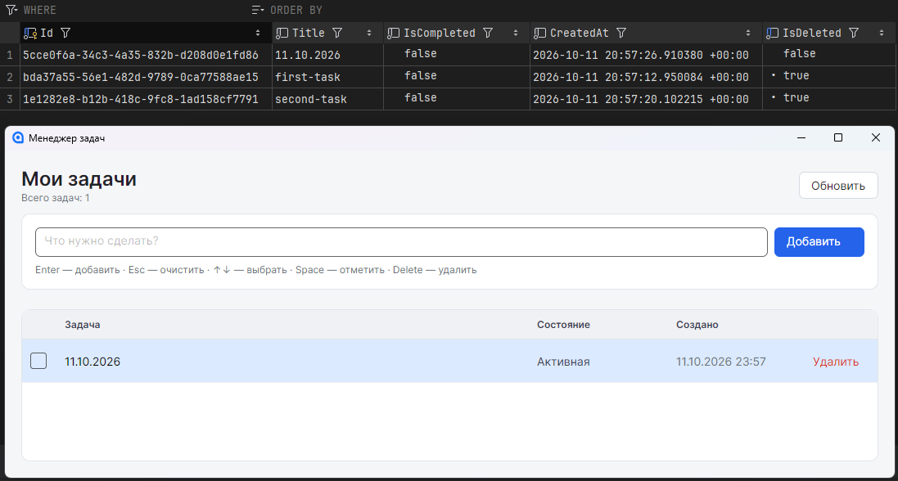
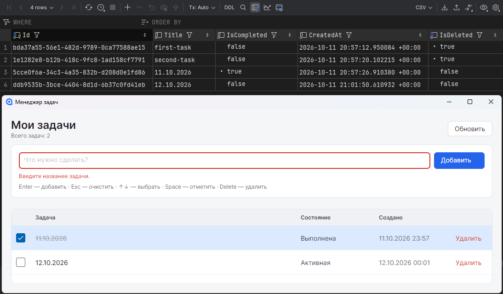

# TaskManager

Десктопное приложение для управления списком задач.
Avalonia, EF Core, PostgreSQL.

## Как собрать и запустить

PostgreSQL на localhost:5432
логин: postgres
пароль: postgres
имя базы: taskdb

Строка подключения лежит в TaskManager.Desktop/appsettings.json, ключ ConnectionStrings:TaskDb.

```cmd
dotnet run --project TaskManager.Desktop
```

## Как применить миграции

Миграции применяются автоматически при старте.

Применение миграций вручную:

```cmd
dotnet ef database update --project TaskManager.Infrastructure --startup-project TaskManager.Infrastructure
```

## Архитектура

Три слоя, зависимости идут только внутрь: Desktop зависит от Infrastructure и Domain, Infrastructure зависит от Domain, Domain ни от кого.

TaskManager.Domain - сущность TaskItem с правилами валидации и интерфейс ITaskRepository, без внешних зависимостей.

TaskManager.Infrastructure - DbContext, репозиторий, конфигурация EF, миграции.

TaskManager.Desktop - Views, ViewModels, точка входа, DI.

Desktop.Views - содержит только XAML и минимальный code-behind.

Desktop.ViewModels - работают через CommunityToolkit.Mvvm, ObservableProperty и RelayCommand. Стили вынесены в Styles/AppStyles.axaml.

Database: таблица tasks с колонками Id, Title, IsCompleted, CreatedAt, IsDeleted. Стоит индекс на IsDeleted.

## Скриншоты







## Что выполнено

- Список задач в виде таблицы: название, состояние, дата создания
- Добавление задачи
- Отметка выполнения чекбоксом
- Удаление через soft delete, строка остаётся в базе
- Асинхронные операции с базой
- Логирование через ILogger
- Автоматическое применение миграций при старте
- Валидация Title с подсветкой поля и сообщением об ошибке
- Обработка ошибки БД при старте
- Клавиатурная навигация: Enter, Esc, стрелки, Space, Delete, Ctrl+R
- Unit тесты

## Что не выполнено

- Глобальный обработчик исключений в полном виде (сделан только для старта)
- Очистка удалённых задач.

## Противоречия в ТЗ

- Вначале написано про PostgreSQL, в техтребованиях про провайдер PostgreSQL, следом же про локальный файл tasks.db и упоминание LiteDb

- В требованиях указано про разделение на слои Domain, Infrastructure, Presentation, а рекомендуемая структура содержит проект с папками Models, Services, ViewModels, Views.

- В требованиях указано soft-delete, а в модели TaskItem только четыре поля, без флага IsDeleted.